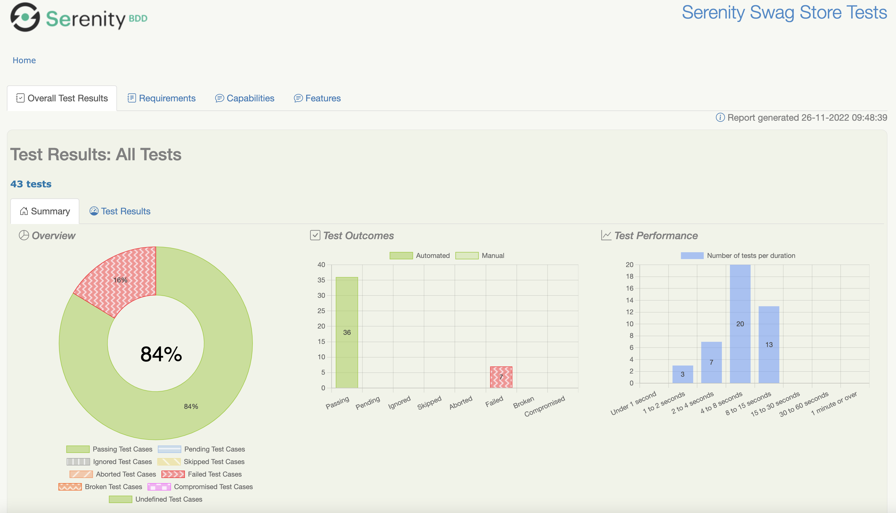
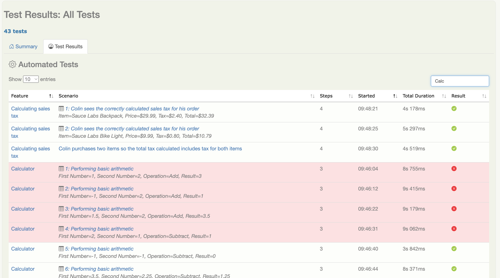
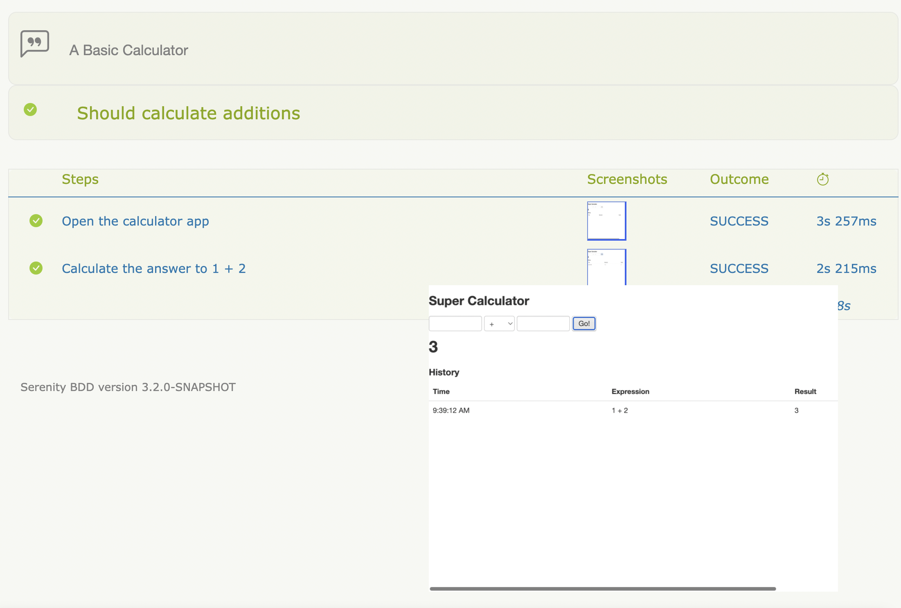
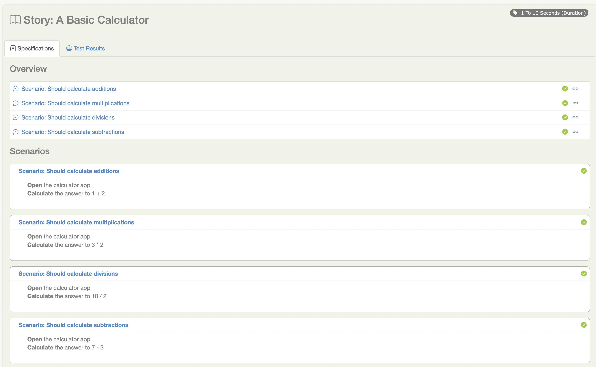

# Serenity 报告：用真实截图理解记录了什么

以下四张图片来自 Serenity 官方文档，通过网络搜索找到并核对原始页面。它们展示官方示例项目，不是 NPA 的运行结果，也不是同一轮测试的完整连续记录。文档保留了一些旧版本截图，实际界面会随版本与配置变化。

新版六页 PPT 的架构页放大展示了第三张图的步骤表格；这里保留完整图片，方便查看细节。

## 1. 测试总览：这次跑出来的结果是什么



这里可以查看结果分布与执行耗时。它用于了解本次已执行测试的表现；判断是否达到发布要求，还需要对照实际执行范围与团队标准。[官方报告说明](https://serenity-bdd.github.io/docs/reporting/the_serenity_reports)

讲解时可以说：“这里先看整套测试的结果分布，发现有失败后，再进入具体场景查原因。”

## 2. 结果列表：哪条场景失败了



Feature、Scenario 帮助定位检查的行为；Steps、Started、Total Duration、Result 展示执行信息。带数据表标记的结果可能来自数据驱动测试，同一场景的不同输入可以产生多条结果。[官方 Test Results 说明](https://serenity-bdd.github.io/docs/reporting/the_serenity_reports#test-results)

讲解时可以说：“我们不是只看一个红色结果，而是先找到失败的场景和对应输入，再去看详细步骤。”

## 3. 步骤与页面截图：失败前执行了什么



这是官方计算器例子。Steps 列出执行动作，Screenshots 列关联被测页面的截图，Outcome 和右侧耗时提供执行结果。图中的大图展示计算器页面；报告截图与测试运行时采集的页面截图是两种不同的图片。[官方 Step Libraries 说明](https://serenity-bdd.github.io/docs/guide/step_libraries)

讲解时可以说：“这就是‘记录执行过程’的实际样子：能看到操作顺序，再结合当时页面检查执行到了哪里。截图只是证据，是否满足需求仍由断言判断。”

截图数量取决于配置。例如，UI 测试可以只保留失败时的截图；并非每种测试都有浏览器画面。[官方截图配置](https://serenity-bdd.github.io/docs/reference/serenity-properties#serenitytakescreenshots)

```properties
# serenity.properties：UI 测试只保存失败步骤的截图
serenity.take.screenshots=FOR_FAILURES
```

## 4. 场景与步骤的对应关系



这里能看到多个计算器场景，以及每条场景下面的执行步骤。它说明报告如何把“检查什么行为”与“如何执行检查”放在一起。[官方示例说明](https://serenity-bdd.github.io/docs/guide/step_libraries)

你们使用 Cucumber 时，应让 `.feature` 场景通过项目中的 Serenity / Cucumber 集成执行；Java 方法的子步骤是否出现在报告中，也取决于如何接入记录机制。Step Library 模式下，官方用 `@Steps` 管理实例、用 `@Step` 标记要记录的方法。普通 helper 方法不会仅因为被调用就全部变成报告步骤。[官方 Step Library 记录机制](https://serenity-bdd.github.io/docs/guide/step_libraries#implementing-simple-step-libraries)

## 对应 NPA 例子，怎样讲得具体

“我们定义一条 Unit A sign-off 的场景。Java 代码提交操作，再重新打开同一 proposal 读取状态并断言。报告应该让我们找到这条场景、看到已记录的操作与检查结果，并在配置允许时查看对应页面截图。这样失败后能判断是提交步骤、页面加载，还是状态断言出了问题。”

这里描述的是预期实现方式；目前示例代码尚未对接 NPA 项目运行。截图不会替代对持久化状态与权限规则的断言。

## 图片原始链接

| 图片 | 原始图片 |
| --- | --- |
| 结果总览 | [官方 PNG](https://serenity-bdd.github.io/assets/images/reports-overview-71f7fb1aae958453fc042f9b385fff85.png) |
| 场景结果列表 | [官方 PNG](https://serenity-bdd.github.io/assets/images/test-results-2b204165143994d93b7a1480dd1b5915.png) |
| 步骤与页面截图 | [官方 PNG](https://serenity-bdd.github.io/assets/images/calculator-step-screenshots-f155907793e985d481afe765cc342085.png) |
| 场景与展开步骤 | [官方 PNG](https://serenity-bdd.github.io/assets/images/calculator-steps-5da4a36b105ab6c58ccc74f377dab106.png) |

核对日期：2026-10-12。
